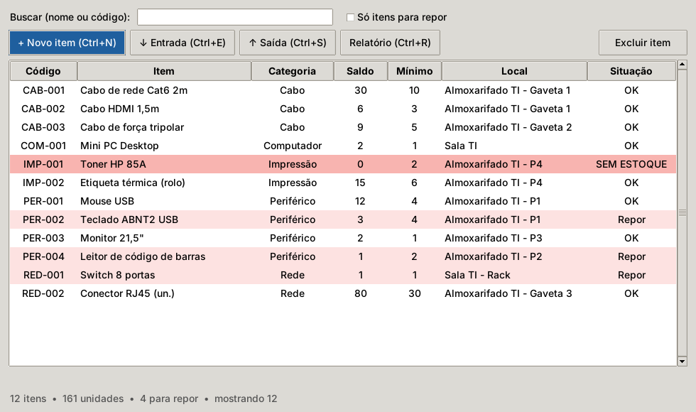

# Estoque de TI — Hospital

Sistema desktop em **Python + Tkinter** para controlar o estoque de equipamentos
e insumos de TI de um hospital (periféricos, cabos, toners, peças de rede):
cadastro, entrada, saída por setor, alerta de estoque mínimo e relatórios.

Projeto Integrador: Laboratório de Programação. Engenharia de Software, UNISA, 2026/2.
Autor: Arthur Sparvoli de Araujo.



## Funcionalidades

- Cadastro de itens com código automático por categoria (`PER-001`, `CAB-002`...)
- Entrada e saída com setor de destino e responsável. Bloqueia saída maior que o saldo.
- Destaque em vermelho para itens abaixo do mínimo ou zerados
- Busca em tempo real por nome ou código (ignora acentos e maiúsculas)
- Ordenação clicando no cabeçalho de qualquer coluna
- Relatório: resumo, lista de compra sugerida, saídas por setor e matriz de saídas por dia da semana
- Dados salvos em JSON com escrita atômica (não corrompe se o programa cair)
- Atalhos: `Ctrl+N` novo, `Ctrl+E` entrada, `Ctrl+S` saída, `Ctrl+R` relatório, `Ctrl+F` busca

## Como executar

Requer Python 3.10+ (o Tkinter já vem no instalador oficial do Windows).

```bash
python app.py
```

Testes automatizados:

```bash
python -m unittest discover -s testes -v   # 25 testes unitários do núcleo
python testes/bot_e2e.py                   # bot executa as 5 tarefas na janela
```

Medições de desempenho e análise de usabilidade (precisam do matplotlib):

```bash
pip install -r requirements.txt
python medicoes/benchmark.py              # desempenho por tamanho de estoque
python medicoes/teste_carga.py            # 50 bots, 10.000 operações
python usabilidade/klm.py                 # estimativa de tempo das tarefas (KLM)
python usabilidade/analisar_usabilidade.py  # SUS, depois do teste com pessoas
```

## Arquitetura

| Arquivo | Responsabilidade |
|---|---|
| `estoque.py` | Regras de negócio, sem nenhuma dependência de interface |
| `app.py` | Interface Tkinter, que chama o núcleo |
| `testes/` | Testes unitários do núcleo e bot ponta a ponta |
| `medicoes/` | Benchmark e teste de carga (ISO/IEC 25010) |
| `usabilidade/` | KLM, roteiro, questionário SUS e análise do teste com usuários |
| `relatorio/` | Relatório do Projeto Integrador (.docx) |

Conteúdos aplicados: registros (`dataclass`), vetores e arranjos de registros,
pesquisa sequencial e binária (iterativa e recursiva), ordenação por inserção,
matrizes, cadeias de caracteres, procedimentos e funções recursivas.

O passo a passo do código está em [GUIA_DE_ESTUDO.md](GUIA_DE_ESTUDO.md).
